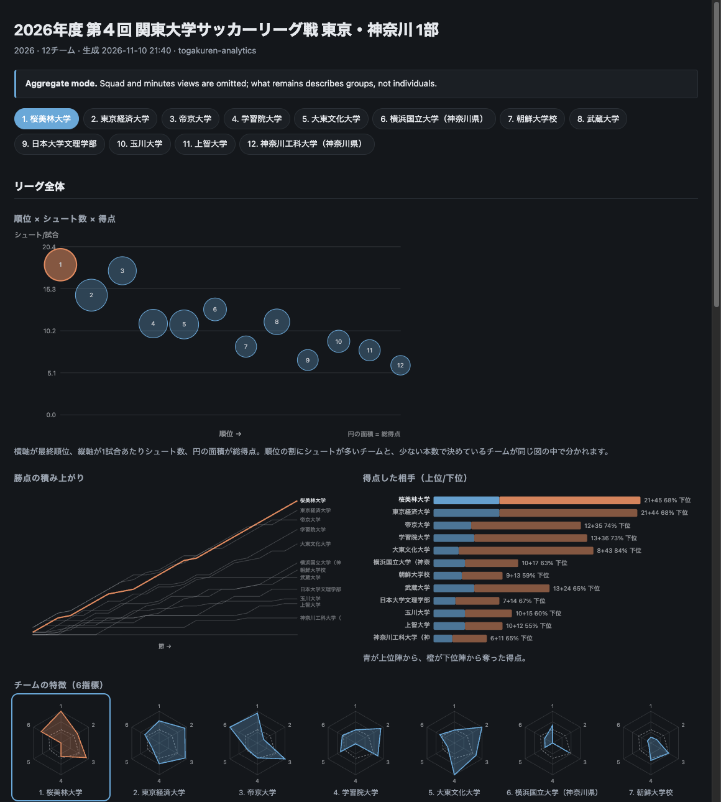
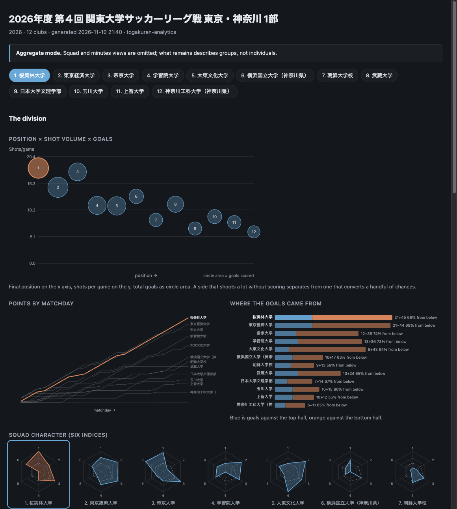

# togakuren-analytics

[日本語](#日本語) | [English](#english)

[](https://github.com/sean-from-japan/togakuren-analytics/actions/workflows/ci.yml)


## 日本語

東京都大学サッカー連盟の公開記録を、データベースと検証つきの分析に変えるPythonツールです。2,000試合以上・53クラブ・2021〜2026年を扱い、依存は標準ライブラリだけ、収集したデータはリポジトリに含みません。

[公開ページ](https://sean-from-japan.github.io/togakuren-analytics/)では、2026年1〜3部のダッシュボード（勝率予測付き）とシーズン横断分析を閲覧できます。

**2026年11月10日更新。** 2026年1〜3部は全327試合終了。[シーズン別分析](docs/seasons/README.md)と[シーズン横断分析](docs/SEASON_TRENDS.ja.md)を最終成績に更新しました。公開中の全34大会・2,337試合を再取得し、カップ戦は11月8日までの結果を含みます。以下の予測・検証結果は各文書に記した時点の実験です。



### 主な結果

- **開幕前のメンバー表が、前年の最終順位表より当たります。** 出身高校とクラブユース出身者の比率だけで、部の平均に対して+12.8%。前年の順位表だけでは−0.2%です。
- **勝敗予測は、設定を決めた後の597試合で検証しています。** 対数損失は1.0174 → 0.8211で、Eloの0.8672を上回りました。
- **間違いと失敗も残しています。** リーグ再編の読み違いで昇降格の21%を逆に分類していたことが分かり、その結果に基づく主張を撤回しました。改善するはずだった2つの案が外れた経緯も書いています。
- **名前を消しても匿名にはなりません。** チーム・ポジション・出場数だけで2026年1部の選手の56%が特定できることを実測し、公開用の出力はそれを前提に制限しています。

[詳しい分析結果](FINDINGS.ja.md) · [日本語README](README.ja.md)

### 使い方

```bash
git clone https://github.com/sean-from-japan/togakuren-analytics
cd togakuren-analytics
pip install .
togakuren ingest                                   # 約40秒
togakuren dashboard --series "2026 1部" --forecast
togakuren intake --year 2026 --level 1              # 開幕前の予測順位
```

名簿と日程を取り込むと、初戦前でも `intake` で予測順位を出せます。詳しい手順は[日本語README](README.ja.md#開幕前の予測)を参照してください。

東京都大学サッカー連盟とは無関係の個人プロジェクトです。

## English

A standard-library-only Python toolkit that turns the Tokyo University Football Association's published match records into a database and a set of tested measurements: over 2,000 fixtures, 53 clubs, 2021–2026, and no collected data in the repository.

The [live site](https://sean-from-japan.github.io/togakuren-analytics/) hosts the 2026 dashboards with forecasts and the cross-season analysis.

**Refreshed 10 November 2026.** All 327 league fixtures in the 2026 divisions 1–3 are complete. [Season profiles](docs/seasons/README.md) and [cross-season analysis](docs/SEASON_TRENDS.en.md) now use the final results. The refresh covers all 34 published competitions and 2,337 fixtures, including cup results through 8 November. Forecast experiments below retain their documented cut-offs.



### Highlights

- **The squad list beats last year's table.** Published before a ball is kicked, it scores +12.8% against the division average; last year's final table alone scores −0.2%.
- **Forecasts are scored on fixtures the settings never saw.** On 597 held-out fixtures, log loss goes 1.0174 → 0.8211, past Elo at 0.8672.
- **Mistakes and failures stay on the record.** A misread league reorganisation reversed 21% of division changes and one claim was withdrawn; two well-motivated improvements that failed are written up.
- **Removing names is not anonymisation.** Club, position and appearances alone identify 56% of the 2026 first division, so public output is restricted accordingly.

[Full findings](FINDINGS.en.md) · [English README](README.en.md)

### Quick start

```bash
git clone https://github.com/sean-from-japan/togakuren-analytics
cd togakuren-analytics
pip install .
togakuren ingest                                   # about 40 seconds
togakuren dashboard --series "2026 1部" --forecast
togakuren intake --year 2026 --level 1              # preseason club ranking
```

`intake` can rank clubs before the first match once their squads and fixtures are loaded. See the [English README](README.en.md#preseason-rankings) for details.

This is an independent project with no affiliation to the Tokyo University Football Association.
