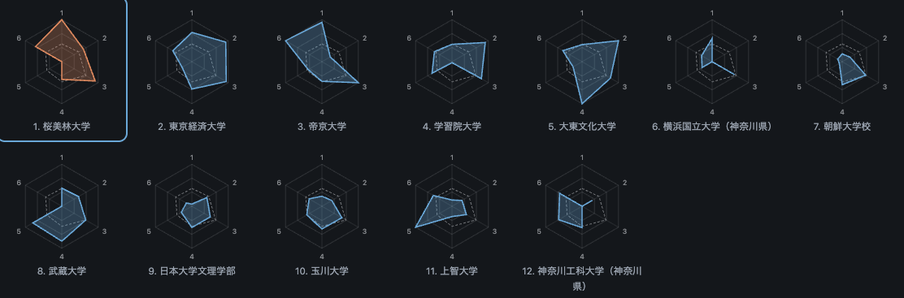

# チーム分析 — 2026年度 第４回 関東大学サッカーリーグ戦 東京・神奈川 1部

*[English](2026-d1.en.md)*

連盟が公開している試合記録をもとに、その部の全チームを集計した文書。選手個人の情報は掲載していません（[../DATA_POLICY.ja.md](../DATA_POLICY.ja.md)）。

2026 1部リーグ。シーズンは終了しているため、この文書は確定です。同じ記録に同じ処理をかければそのまま再現されます。再生成は `togakuren profiles --series "2026 1部リーグ" --lang ja`。

## 順位表

| 順位 | チーム | 試合 | 勝点 | 勝-分-敗 | 得点 | 失点 | 得失点 | シュート | 1試合平均 | 決定率 |
| --- | --- | --: | --: | --: | --: | --: | --: | --: | --: | --: |
| 1 | 桜美林大学 | 22 | 56 | 17-5-0 | 66 | 18 | 48 | 400 | 18.2 | 0.165 |
| 2 | 東京経済大学 | 22 | 52 | 16-4-2 | 65 | 16 | 49 | 319 | 14.5 | 0.204 |
| 3 | 帝京大学 | 22 | 48 | 15-3-4 | 47 | 12 | 35 | 384 | 17.5 | 0.122 |
| 4 | 学習院大学 | 22 | 44 | 13-5-4 | 49 | 26 | 23 | 243 | 11.0 | 0.202 |
| 5 | 大東文化大学 | 22 | 38 | 11-5-6 | 51 | 28 | 23 | 241 | 11.0 | 0.212 |
| 6 | 横浜国立大学（神奈川県） | 22 | 30 | 9-3-10 | 27 | 40 | -13 | 281 | 12.8 | 0.096 |
| 7 | 朝鮮大学校 | 22 | 27 | 8-3-11 | 22 | 38 | -16 | 182 | 8.3 | 0.121 |
| 8 | 武蔵大学 | 22 | 24 | 6-6-10 | 37 | 37 | 0 | 248 | 11.3 | 0.149 |
| 9 | 日本大学文理学部 | 22 | 19 | 5-4-13 | 21 | 48 | -27 | 146 | 6.6 | 0.144 |
| 10 | 玉川大学 | 22 | 15 | 4-3-15 | 25 | 45 | -20 | 196 | 8.9 | 0.128 |
| 11 | 上智大学 | 22 | 13 | 3-4-15 | 22 | 56 | -34 | 172 | 7.8 | 0.128 |
| 12 | 神奈川工科大学（神奈川県） | 22 | 7 | 2-1-19 | 17 | 85 | -68 | 132 | 6.0 | 0.129 |

## チームの特徴

6指標をこの部の中で相対化した値。頂点の番号1〜6は上から時計回りで、各クラブの項目に並ぶ指標と同じ順序。点線はこの部の平均。図はダッシュボードの表示例です。対象シーズンの値は、以下の各クラブの指標を参照してください。

### 1. 桜美林大学

22試合 / 勝点56 / 66得点18失点 / シュートは1試合平均18.2本、決定率0.165 / 29人を起用し、主力11人が出場時間の73%を占める / 平均学年3.30

**指標** — シュート数 100 / 決定率 60 / 守備 92 / ターンオーバー 42 / 下級生比率 0 / 後半の比重 72

上位陣から21点、下位陣から45点（下位陣からの得点が68%）。

**学年別**

| 学年 | 人数 | 出場時間(分) | 得点 |
| --- | --: | --: | --: |
| 1 | 6 | 2265 | 9 |
| 2 | 4 | 2503 | 0 |
| 3 | 3 | 3345 | 6 |
| 4 | 16 | 13667 | 50 |

**過去シーズン**

| 年度 | 部 | 試合 | 勝-分-敗 | 勝点 | 1試合平均 | 得点 | 得失 |
| --- | --- | --: | --: | --: | --: | --: | --: |
| 2021 | 2部リーグ | 18 | 3-2-13 | 11 | 0.61 | 22 | -42 |
| 2022 | チャレンジリーグ | 15 | 10-3-2 | 33 | 2.2 | 75 | 51 |
| 2023 | チャレンジリーグ | 13 | 13-0-0 | 39 | 3.0 | 84 | 73 |
| 2024 | 2部リーグ | 18 | 14-2-2 | 44 | 2.44 | 60 | 51 |
| 2025 | 1部リーグ | 22 | 13-3-6 | 42 | 1.91 | 44 | 17 |
| 2026 | 1部リーグ | 22 | 17-5-0 | 56 | 2.55 | 66 | 48 |

### 2. 東京経済大学

22試合 / 勝点52 / 65得点16失点 / シュートは1試合平均14.5本、決定率0.204 / 45人を起用し、主力11人が出場時間の69%を占める / 平均学年2.44

**指標** — シュート数 70 / 決定率 93 / 守備 94 / ターンオーバー 65 / 下級生比率 27 / 後半の比重 52

上位陣から21点、下位陣から44点（下位陣からの得点が68%）。

**学年別**

| 学年 | 人数 | 出場時間(分) | 得点 |
| --- | --: | --: | --: |
| 1 | 7 | 1162 | 0 |
| 2 | 6 | 4942 | 17 |
| 3 | 13 | 10714 | 29 |
| 4 | 4 | 2471 | 8 |

**過去シーズン**

| 年度 | 部 | 試合 | 勝-分-敗 | 勝点 | 1試合平均 | 得点 | 得失 |
| --- | --- | --: | --: | --: | --: | --: | --: |
| 2021 | 1部リーグ | 24 | 12-5-7 | 41 | 1.71 | 33 | 13 |
| 2022 | 1部リーグ | 22 | 14-4-4 | 46 | 2.09 | 34 | 11 |
| 2026 | 1部リーグ | 22 | 16-4-2 | 52 | 2.36 | 65 | 49 |

### 3. 帝京大学

22試合 / 勝点48 / 47得点12失点 / シュートは1試合平均17.5本、決定率0.122 / 29人を起用し、主力11人が出場時間の72%を占める / 平均学年2.91

**指標** — シュート数 94 / 決定率 23 / 守備 100 / ターンオーバー 47 / 下級生比率 38 / 後半の比重 100

上位陣から12点、下位陣から35点（下位陣からの得点が74%）。

**学年別**

| 学年 | 人数 | 出場時間(分) | 得点 |
| --- | --: | --: | --: |
| 1 | 6 | 2142 | 2 |
| 2 | 6 | 4502 | 6 |
| 3 | 9 | 8345 | 11 |
| 4 | 8 | 6791 | 28 |

**過去シーズン**

| 年度 | 部 | 試合 | 勝-分-敗 | 勝点 | 1試合平均 | 得点 | 得失 |
| --- | --- | --: | --: | --: | --: | --: | --: |
| 2021 | 1部リーグ | 24 | 11-1-12 | 34 | 1.42 | 38 | 1 |
| 2022 | 1部リーグ | 22 | 6-3-13 | 21 | 0.95 | 24 | -31 |
| 2023 | 1部リーグ | 22 | 16-2-4 | 50 | 2.27 | 46 | 27 |
| 2024 | 1部リーグ | 22 | 17-4-1 | 55 | 2.5 | 62 | 52 |
| 2025 | 1部リーグ | 22 | 19-1-2 | 58 | 2.64 | 58 | 46 |
| 2026 | 1部リーグ | 22 | 15-3-4 | 48 | 2.18 | 47 | 35 |

### 4. 学習院大学

22試合 / 勝点44 / 49得点26失点 / シュートは1試合平均11.0本、決定率0.202 / 24人を起用し、主力11人が出場時間の81%を占める / 平均学年2.86

**指標** — シュート数 41 / 決定率 91 / 守備 81 / ターンオーバー 2 / 下級生比率 55 / 後半の比重 48

上位陣から13点、下位陣から36点（下位陣からの得点が73%）。

**学年別**

| 学年 | 人数 | 出場時間(分) | 得点 |
| --- | --: | --: | --: |
| 1 | 6 | 2306 | 4 |
| 2 | 4 | 5189 | 12 |
| 3 | 6 | 7579 | 9 |
| 4 | 8 | 6706 | 23 |

**過去シーズン**

| 年度 | 部 | 試合 | 勝-分-敗 | 勝点 | 1試合平均 | 得点 | 得失 |
| --- | --- | --: | --: | --: | --: | --: | --: |
| 2021 | 1部リーグ | 24 | 8-2-14 | 26 | 1.08 | 32 | -11 |
| 2022 | 1部リーグ | 22 | 6-4-12 | 22 | 1.0 | 27 | -21 |
| 2023 | 1部リーグ | 22 | 10-5-7 | 35 | 1.59 | 35 | 4 |
| 2024 | 1部リーグ | 22 | 8-7-7 | 31 | 1.41 | 36 | 9 |
| 2025 | 1部リーグ | 22 | 8-4-10 | 28 | 1.27 | 38 | 0 |
| 2026 | 1部リーグ | 22 | 13-5-4 | 44 | 2.0 | 49 | 23 |

### 5. 大東文化大学

22試合 / 勝点38 / 51得点28失点 / シュートは1試合平均11.0本、決定率0.212 / 32人を起用し、主力11人が出場時間の61%を占める / 平均学年3.21

**指標** — シュート数 41 / 決定率 100 / 守備 78 / ターンオーバー 100 / 下級生比率 25 / 後半の比重 53

上位陣から8点、下位陣から43点（下位陣からの得点が84%）。

**学年別**

| 学年 | 人数 | 出場時間(分) | 得点 |
| --- | --: | --: | --: |
| 1 | 1 | 45 | 0 |
| 2 | 11 | 5944 | 19 |
| 3 | 9 | 5099 | 6 |
| 4 | 11 | 10652 | 26 |

**過去シーズン**

| 年度 | 部 | 試合 | 勝-分-敗 | 勝点 | 1試合平均 | 得点 | 得失 |
| --- | --- | --: | --: | --: | --: | --: | --: |
| 2021 | 1部リーグ | 24 | 4-6-14 | 18 | 0.75 | 11 | -32 |
| 2022 | 2部リーグ | 20 | 19-0-1 | 57 | 2.85 | 56 | 45 |
| 2023 | 1部リーグ | 22 | 12-6-4 | 42 | 1.91 | 34 | 19 |
| 2024 | 1部リーグ | 22 | 14-4-4 | 46 | 2.09 | 58 | 26 |
| 2025 | 1部リーグ | 22 | 16-2-4 | 50 | 2.27 | 55 | 32 |
| 2026 | 1部リーグ | 22 | 11-5-6 | 38 | 1.73 | 51 | 23 |

### 6. 横浜国立大学（神奈川県）

22試合 / 勝点30 / 27得点40失点 / シュートは1試合平均12.8本、決定率0.096 / 31人を起用し、主力11人が出場時間の82%を占める / 平均学年2.75

**指標** — シュート数 56 / 決定率 0 / 守備 62 / ターンオーバー 0 / 下級生比率 28 / 後半の比重 29

上位陣から10点、下位陣から17点（下位陣からの得点が63%）。

**学年別**

| 学年 | 人数 | 出場時間(分) | 得点 |
| --- | --: | --: | --: |
| 1 | 5 | 2017 | 0 |
| 2 | 8 | 4128 | 7 |
| 3 | 6 | 5552 | 6 |
| 4 | 11 | 8244 | 3 |

**過去シーズン**

| 年度 | 部 | 試合 | 勝-分-敗 | 勝点 | 1試合平均 | 得点 | 得失 |
| --- | --- | --: | --: | --: | --: | --: | --: |
| 2023 | 1部リーグ | 22 | 4-7-11 | 19 | 0.86 | 24 | -14 |
| 2024 | 2部リーグ | 18 | 14-2-2 | 44 | 2.44 | 67 | 46 |
| 2025 | 1部リーグ | 22 | 10-4-8 | 34 | 1.55 | 34 | 0 |
| 2026 | 1部リーグ | 22 | 9-3-10 | 30 | 1.36 | 27 | -13 |

### 7. 朝鮮大学校

22試合 / 勝点27 / 22得点38失点 / シュートは1試合平均8.3本、決定率0.121 / 34人を起用し、主力11人が出場時間の71%を占める / 平均学年2.96

**指標** — シュート数 19 / 決定率 22 / 守備 64 / ターンオーバー 55 / 下級生比率 8 / 後半の比重 12

上位陣から9点、下位陣から13点（下位陣からの得点が59%）。

**学年別**

| 学年 | 人数 | 出場時間(分) | 得点 |
| --- | --: | --: | --: |
| 1 | 6 | 2074 | 0 |
| 2 | 5 | 3082 | 3 |
| 3 | 6 | 6575 | 12 |
| 4 | 9 | 9133 | 6 |

**過去シーズン**

| 年度 | 部 | 試合 | 勝-分-敗 | 勝点 | 1試合平均 | 得点 | 得失 |
| --- | --- | --: | --: | --: | --: | --: | --: |
| 2021 | 1部リーグ | 24 | 7-4-13 | 25 | 1.04 | 22 | -12 |
| 2022 | 1部リーグ | 22 | 8-4-10 | 28 | 1.27 | 29 | -10 |
| 2023 | 1部リーグ | 22 | 16-4-2 | 52 | 2.36 | 48 | 32 |
| 2024 | 1部リーグ | 22 | 8-4-10 | 28 | 1.27 | 43 | -2 |
| 2025 | 1部リーグ | 22 | 6-2-14 | 20 | 0.91 | 22 | -26 |
| 2026 | 1部リーグ | 22 | 8-3-11 | 27 | 1.23 | 22 | -16 |

### 8. 武蔵大学

22試合 / 勝点24 / 37得点37失点 / シュートは1試合平均11.3本、決定率0.149 / 39人を起用し、主力11人が出場時間の65%を占める / 平均学年2.89

**指標** — シュート数 43 / 決定率 46 / 守備 66 / ターンオーバー 83 / 下級生比率 80 / 後半の比重 0

上位陣から13点、下位陣から24点（下位陣からの得点が65%）。

**学年別**

| 学年 | 人数 | 出場時間(分) | 得点 |
| --- | --: | --: | --: |
| 1 | 9 | 2205 | 10 |
| 2 | 12 | 6516 | 15 |
| 3 | 6 | 4466 | 3 |
| 4 | 12 | 8581 | 8 |

**過去シーズン**

| 年度 | 部 | 試合 | 勝-分-敗 | 勝点 | 1試合平均 | 得点 | 得失 |
| --- | --- | --: | --: | --: | --: | --: | --: |
| 2021 | 2部リーグ | 18 | 8-6-4 | 30 | 1.67 | 34 | 14 |
| 2022 | 2部リーグ | 20 | 10-3-7 | 33 | 1.65 | 42 | 21 |
| 2023 | 1部リーグ | 22 | 6-3-13 | 21 | 0.95 | 24 | -13 |
| 2024 | 1部リーグ | 22 | 9-6-7 | 33 | 1.5 | 48 | 8 |
| 2025 | 1部リーグ | 22 | 12-3-7 | 39 | 1.77 | 44 | 8 |
| 2026 | 1部リーグ | 22 | 6-6-10 | 24 | 1.09 | 37 | 0 |

### 9. 日本大学文理学部

22試合 / 勝点19 / 21得点48失点 / シュートは1試合平均6.6本、決定率0.144 / 29人を起用し、主力11人が出場時間の72%を占める / 平均学年2.92

**指標** — シュート数 5 / 決定率 41 / 守備 51 / ターンオーバー 51 / 下級生比率 29 / 後半の比重 15

上位陣から7点、下位陣から14点（下位陣からの得点が67%）。

**学年別**

| 学年 | 人数 | 出場時間(分) | 得点 |
| --- | --: | --: | --: |
| 1 | 5 | 2813 | 4 |
| 2 | 4 | 3390 | 4 |
| 3 | 11 | 8293 | 5 |
| 4 | 9 | 7284 | 8 |

**過去シーズン**

| 年度 | 部 | 試合 | 勝-分-敗 | 勝点 | 1試合平均 | 得点 | 得失 |
| --- | --- | --: | --: | --: | --: | --: | --: |
| 2021 | 3部リーグ | 8 | 3-3-2 | 12 | 1.5 | 20 | 10 |
| 2022 | 2部リーグ | 20 | 11-0-9 | 33 | 1.65 | 32 | -6 |
| 2023 | 2部リーグ | 22 | 16-1-5 | 49 | 2.23 | 66 | 35 |
| 2024 | 1部リーグ | 22 | 7-5-10 | 26 | 1.18 | 31 | -19 |
| 2025 | 1部リーグ | 22 | 10-4-8 | 34 | 1.55 | 33 | 0 |
| 2026 | 1部リーグ | 22 | 5-4-13 | 19 | 0.86 | 21 | -27 |

### 10. 玉川大学

22試合 / 勝点15 / 25得点45失点 / シュートは1試合平均8.9本、決定率0.128 / 31人を起用し、主力11人が出場時間の71%を占める / 平均学年2.93

**指標** — シュート数 24 / 決定率 27 / 守備 55 / ターンオーバー 54 / 下級生比率 42 / 後半の比重 35

上位陣から10点、下位陣から15点（下位陣からの得点が60%）。

**学年別**

| 学年 | 人数 | 出場時間(分) | 得点 |
| --- | --: | --: | --: |
| 1 | 11 | 4426 | 7 |
| 2 | 7 | 2405 | 4 |
| 3 | 5 | 5202 | 6 |
| 4 | 8 | 9735 | 7 |

**過去シーズン**

| 年度 | 部 | 試合 | 勝-分-敗 | 勝点 | 1試合平均 | 得点 | 得失 |
| --- | --- | --: | --: | --: | --: | --: | --: |
| 2021 | 2部リーグ | 18 | 12-3-3 | 39 | 2.17 | 42 | 26 |
| 2022 | 1部リーグ | 22 | 2-2-18 | 8 | 0.36 | 16 | -36 |
| 2023 | 1部リーグ | 22 | 7-2-13 | 23 | 1.05 | 28 | -8 |
| 2024 | 1部リーグ | 22 | 4-9-9 | 21 | 0.95 | 24 | -16 |
| 2025 | 1部リーグ | 22 | 11-4-7 | 37 | 1.68 | 32 | 8 |
| 2026 | 1部リーグ | 22 | 4-3-15 | 15 | 0.68 | 25 | -20 |

### 11. 上智大学

22試合 / 勝点13 / 22得点56失点 / シュートは1試合平均7.8本、決定率0.128 / 34人を起用し、主力11人が出場時間の77%を占める / 平均学年2.56

**指標** — シュート数 15 / 決定率 28 / 守備 40 / ターンオーバー 25 / 下級生比率 100 / 後半の比重 51

上位陣から10点、下位陣から12点（下位陣からの得点が55%）。

**学年別**

| 学年 | 人数 | 出場時間(分) | 得点 |
| --- | --: | --: | --: |
| 1 | 11 | 5647 | 4 |
| 2 | 8 | 4100 | 7 |
| 3 | 8 | 6310 | 4 |
| 4 | 7 | 5723 | 7 |

**過去シーズン**

| 年度 | 部 | 試合 | 勝-分-敗 | 勝点 | 1試合平均 | 得点 | 得失 |
| --- | --- | --: | --: | --: | --: | --: | --: |
| 2021 | 2部リーグ | 18 | 15-3-0 | 48 | 2.67 | 41 | 33 |
| 2022 | 1部リーグ | 22 | 2-6-14 | 12 | 0.55 | 19 | -28 |
| 2023 | 1部リーグ | 22 | 9-5-8 | 32 | 1.45 | 30 | 5 |
| 2024 | 1部リーグ | 22 | 4-5-13 | 17 | 0.77 | 16 | -29 |
| 2025 | 2部リーグ | 18 | 11-4-3 | 37 | 2.06 | 33 | 16 |
| 2026 | 1部リーグ | 22 | 3-4-15 | 13 | 0.59 | 22 | -34 |

### 12. 神奈川工科大学（神奈川県）

22試合 / 勝点7 / 17得点85失点 / シュートは1試合平均6.0本、決定率0.129 / 26人を起用し、主力11人が出場時間の72%を占める / 平均学年2.55

**指標** — シュート数 0 / 決定率 28 / 守備 0 / ターンオーバー 51 / 下級生比率 64 / 後半の比重 62

上位陣から6点、下位陣から11点（下位陣からの得点が65%）。

**学年別**

| 学年 | 人数 | 出場時間(分) | 得点 |
| --- | --: | --: | --: |
| 1 | 9 | 6639 | 4 |
| 2 | 3 | 1327 | 0 |
| 3 | 9 | 8919 | 9 |
| 4 | 5 | 4895 | 4 |

**過去シーズン**

| 年度 | 部 | 試合 | 勝-分-敗 | 勝点 | 1試合平均 | 得点 | 得失 |
| --- | --- | --: | --: | --: | --: | --: | --: |
| 2023 | 2部リーグ | 22 | 9-5-8 | 32 | 1.45 | 38 | 8 |
| 2024 | 2部リーグ | 18 | 12-1-5 | 37 | 2.06 | 56 | 31 |
| 2025 | 2部リーグ | 18 | 11-2-5 | 35 | 1.94 | 34 | 7 |
| 2026 | 1部リーグ | 22 | 2-1-19 | 7 | 0.32 | 17 | -68 |

---

*連盟のクラブIDで追跡しているため、部の変化がそのまま昇降格を表します。*
